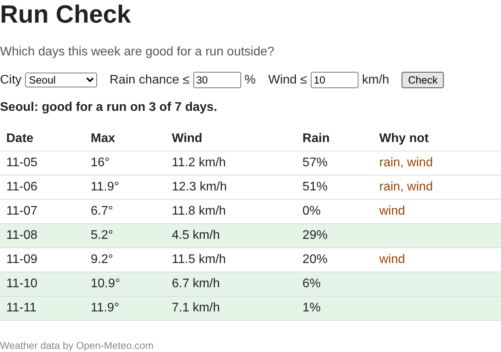

# 10·11주차 과제 — Tests, CI, Back-end Server

9주차 실습에서 **Run Check** 를 만들었습니다. 도시와 기준(강수확률, 풍속)을 정하면 앞으로 7일 중 달리기 좋은 날을 초록색으로 칠하는 페이지입니다. 이 저장소에는 그 완성본이 `public/` 폴더에 들어 있습니다.

이번 과제에서는 화면을 새로 만들지 않습니다. 같은 앱에 아래 세 가지를 붙입니다.

- (1) **테스트** (10주차 녹강 Part 1): 규칙이 맞는지 사람이 눈으로 비교하지 않고 `npm test` 한 줄로 확인합니다.
- (2) **CI** (10주차 녹강 Part 2): push 할 때마다 GitHub 가 그 테스트를 대신 돌립니다.
- (3) **서버** (11주차 녹강): 내 서버가 페이지를 내보내고, 예보를 대신 받아 오고, 비밀 값을 지킵니다.

녹강과 다른 점은 세 가지입니다.

- 녹강의 예제는 Umbrella Check 이고, 과제는 Run Check 입니다. 함수 이름, 받아 오는 항목, 규칙이 다릅니다.
- 녹강의 서버는 메모(Notes)를 모든 방문자가 공유하고 토큰으로 지우기를 막았습니다. 과제의 서버는 **도시별 요청 횟수**를 세고, 토큰으로 그 **통계 읽기**를 막습니다.
- 문제마다 무엇을 만들지와 확인 방법은 정확히 적혀 있지만, 코드는 적혀 있지 않습니다. 단계마다 붙은 **참고** 줄이 녹강의 어느 장을 보면 되는지, 슬라이드와 무엇이 다른지 알려 줍니다.

막히면 맨 아래 **부록: 흔한 오류**를 먼저 봅니다.

## 규칙

- **저장소**: 이 저장소를 템플릿으로 내 계정에 `oss-week11` 을 만듭니다(정확히 이 이름, Public). 문제마다 지정된 **커밋 메시지**를 그대로 씁니다.
- **확인 방법**: 저장소의 파일과 커밋, Actions 기록을 봅니다. 따로 제출하는 파일은 없습니다.
- 저장소 어디에도 **이름·학번을 적지 않습니다.**
- 명령은 전부 `oss-week11` 폴더에서 칩니다. 터미널은 두 개를 씁니다. 하나는 서버가 쓰고(P0 ~ P3 은 `npx serve public`, P4 부터는 `npm start`), 다른 하나에서 `npm test`, `curl`, `git` 을 칩니다.
- **문제 하나를 끝낼 때마다 push 합니다.** P3 부터는 push 한 뒤 github.com 의 **Actions** 탭에서 초록 체크까지 보고 다음 문제로 넘어갑니다.
- 문제지의 `curl` 명령은 Git Bash 와 macOS 터미널 기준입니다. **Windows PowerShell 에서는 `curl` 대신 `curl.exe`** 라고 칩니다(부록 E15).
- 문제지의 브라우저 메시지와 개발자 도구 메뉴 이름은 영어 Chrome 기준입니다. 한국어 Chrome 이면 번역되어 보입니다.

## 파일

| 파일 | 하는 일 | 채우는 문제 |
|---|---|---|
| `public/index.html`, `public/style.css` | 화면 뼈대와 모양. 주어짐 | — |
| `public/logic.js` | 규칙(순수 함수). 주어짐. **고치지 않음** | P2 의 확인에서 잠깐 |
| `public/api.js`, `public/main.js` | 예보 받기, 화면 담당. 주어짐 | P5 에서 고침 |
| `logic.test.js` | 규칙 테스트. 예시 1개가 들어 있음 | P1, P2 |
| `package.json` | 패키지 목록과 스크립트 | P1, P4, P6 |
| `.github/workflows/test.yml` | CI 설정. **새로 만듦** | P3 |
| `server.js` | 내 서버 | P4, P5, P6 |
| `openMeteo.js` | 서버가 Open-Meteo 를 부르는 코드 | P5 |
| `data/` | Open-Meteo 가 응답하지 않을 때 쓰는 저장된 응답(부록 E19) | — |
| `.env`, `.env.example` | 비밀 값과 그 견본. **새로 만듦** | P6 |

`public/` 안의 파일은 브라우저로 내보내는 것이고, 밖의 파일은 내 컴퓨터(나중에는 서버 컴퓨터)에서만 쓰는 것입니다. 파일마다 맨 위 주석에 그 파일에서 할 일이 적혀 있습니다.

---

## 문제

| # | 문제 | 남는 것 |
|---|---|---|
| [P0](problems/P0_setup.md) | [내 저장소 만들고 띄우기](problems/P0_setup.md) | 저장소 `oss-week11` |
| [P1](problems/P1_vitest.md) | [vitest 를 설치하고 첫 테스트 돌리기](problems/P1_vitest.md) | 커밋 `p1: vitest` |
| [P2](problems/P2_tests.md) | [규칙을 테스트로 옮기기](problems/P2_tests.md) | 커밋 `p2: tests` |
| [P3](problems/P3_ci.md) | [push 할 때마다 GitHub 가 테스트하게 하기](problems/P3_ci.md) | 커밋 `p3: ci`, Actions 초록 |
| [P4](problems/P4_server.md) | [내 서버로 페이지 내보내기](problems/P4_server.md) | 커밋 `p4: server` |
| [P5](problems/P5_forecast.md) | [예보를 서버가 받아 오게 옮기기](problems/P5_forecast.md) | 커밋 `p5: forecast` |
| [P6](problems/P6_secret.md) | [토큰이 있어야 보이는 통계](problems/P6_secret.md) | 커밋 `p6: secret` |

## 끝났을 때 갖춰져 있어야 하는 상태

- `<내 ID>/oss-week11` 이 Public, 커밋 `p1: vitest` · `p2: tests` · `p3: ci` · `p4: server` · `p5: forecast` · `p6: secret` 이 push 됨
- `package.json` 의 `devDependencies` 에 `vitest`, `dependencies` 에 `express`. `package-lock.json` 이 커밋되어 있고 `node_modules` 는 저장소에 없음
- `npm test` 가 `9 passed` (또는 그 이상)
- github.com 의 Actions 탭에서 **마지막 커밋이 초록 체크**
- `npm start` 로 서버가 켜지고, `GET /api/health` · `GET /api/forecast?city=seoul` · `GET /api/stats` 가 문제지의 표대로 응답함. 모르는 도시(`tokyo`, `toString`, 값 없음)는 `400`
- `public/api.js` 와 `public/main.js` 에 Open-Meteo 주소와 위도·경도가 없음
- 저장소에 `.env.example` 은 있고 **`.env` 는 없음.** 토큰 값이 어느 파일에도 적혀 있지 않음

---

## 부록: 흔한 오류

| # | 증상 | 원인 → 해결 |
|---|---|---|
| E1 | `npm test` 가 `npm error Missing script: "test"` | `package.json` 에 `scripts` 의 `test` 가 없음, 또는 다른 폴더에서 실행함 → P1 3번. `oss-week11` 폴더인지 확인 |
| E2 | `npm` 명령이 전부 `npm error code EJSONPARSE` | `package.json` 이 JSON 문법에 안 맞음. 대개 마지막 항목 뒤에 쉼표를 남겼거나, 항목 사이 쉼표를 빠뜨림 → 오류의 `line`, `column` 이 가리키는 곳을 봄. 키와 문자열은 큰따옴표 |
| E3 | `npm install -D vitest` 에서 `npm warn EBADENGINE` | Node 버전이 낮음. vitest 5 는 Node 22.12 이상(또는 24)이 필요 → `node -v` 로 확인하고 https://nodejs.org 에서 LTS 를 새로 설치 |
| E4 | `npm test` 가 `No test files found, exiting with code 1` | 테스트 파일 이름이 `.test.js` 로 끝나지 않음(이름을 바꿨거나 지움) → `logic.test.js` 인지 확인 |
| E5 | `npm test` 가 `does not provide an export named 'xxx'` | `import { xxx }` 의 이름이 `public/logic.js` 의 export 와 다름(오타, 대소문자) |
| E6 | 테스트가 `expected [ 'rain' ] to be [ 'rain' ] // Object.is equality` 처럼 같아 보이는데 실패 | 배열·객체를 `toBe` 로 비교함. `toBe` 는 "같은 객체인가" 를 봄 → 내용을 비교하는 `toEqual` |
| E7 | push 했는데 Actions 탭에 아무것도 안 생김 | 파일 위치나 이름이 다름 → 정확히 `.github/workflows/test.yml`. 맨 앞의 점, `workflows` 의 s, 저장소 맨 위 폴더 기준인지 확인. 커밋에 그 파일이 들어갔는지 github.com 에서 확인 |
| E8 | Actions 가 빨간 X 이고 실행 이름 옆에 `Invalid workflow file` | YAML 들여쓰기가 틀림. 탭 문자를 썼거나 칸 수가 어긋남 → 들여쓰기는 스페이스 2칸씩. 10주차 녹강 슬라이드 23장과 줄마다 대조 |
| E9 | Actions 의 `Run npm ci` 단계가 `The npm ci command can only install with an existing package-lock.json` | `package-lock.json` 을 커밋하지 않음 → `git add package-lock.json` 후 커밋·push |
| E10 | Actions 의 `Run npm ci` 단계가 `npm ci can only install packages when your package.json and package-lock.json ... are in sync` 와 `Missing: express@... from lock file` | 패키지를 설치한 뒤 `package.json` 만 커밋하고 `package-lock.json` 을 빠뜨림(P4 에서 자주 생김) → 둘을 같이 커밋·push |
| E11 | `npm start` 가 `Error: listen EADDRINUSE: address already in use` 로 시작하는 오류(뒤에 `:::3000` 이나 `0.0.0.0:3000`) | 3000 포트를 다른 프로그램이 쓰고 있음. 대개 P0 의 `npx serve public` 이나 전에 켠 `npm start` → 그 터미널에서 `Ctrl+C` 한 뒤 다시 실행 |
| E12 | `npm start` 가 `Cannot find package 'express' imported from ...` | `npm install express` 를 안 했거나 다른 폴더에서 함. 저장소를 새로 clone 한 경우에는 `npm install` 한 번이 필요(`node_modules` 는 Git 에 없으므로) |
| E13 | `server.js` 를 고쳤는데 `curl` 결과가 그대로이거나 `Cannot GET /api/...` | 서버를 다시 켜지 않음. Node 는 켤 때 읽은 코드로 계속 돌아감 → 서버 터미널에서 `Ctrl+C` 후 `npm start`. `public/` 안의 파일은 다시 켤 필요 없이 브라우저에서 F5 |
| E14 | 페이지 상태 줄이 `Could not load the forecast (Unexpected token '<', "<!DOCTYPE "... is not valid JSON).` | 페이지는 `/api/forecast` 를 불렀는데 서버에 그 route 가 없어서 Express 가 404 HTML 을 보냄 → `server.js` 의 경로 오타(`/api/forecast`), 서버를 다시 켰는지(E13) 확인 |
| E15 | PowerShell 에서 `curl -i ...` 가 `Invoke-WebRequest : ... 매개 변수를 찾을 수 없습니다` 같은 오류 | Windows PowerShell 의 `curl` 은 다른 명령의 별명임 → `curl.exe -i ...` 로 침. 또는 Git Bash 터미널을 씀 |
| E16 | `curl` 주소에 `?` 가 있을 때 `no matches found` 또는 이상한 결과 | 셸이 `?` 나 `&` 를 다르게 해석함 → 주소를 큰따옴표로 감쌈: `curl -i "http://localhost:3000/api/forecast?city=seoul"` |
| E17 | 요약 줄이 `undefined: good for a run on 3 of 7 days.` | P5 뒤 `state.city` 는 문자열인데 `render` 가 아직 `state.city.name` 을 읽음 → P5 7번 |
| E18 | 서버 터미널에 `Cannot set headers after they are sent to the client` (`ERR_HTTP_HEADERS_SENT`) | 한 요청에 응답을 두 번 보냄. 400 이나 401 을 보낸 줄에 `return` 이 없어서 아래 코드까지 실행됨 → `return res.status(...).json(...)` |
| E19 | 내 코드는 맞는 것 같은데 예보를 못 받음. P0 ~ P4 의 페이지 상태 줄이 `Could not load the forecast (Failed to fetch).`, P5 의 `/api/forecast?city=seoul` 이 `502` 와 `{"error":"fetch failed"}` | Open-Meteo 가 응답하지 않거나 인터넷이 안 됨. 먼저 브라우저 새 탭에서 https://open-meteo.com/en/docs 의 **API URL** 주소를 열어 JSON 이 나오는지 봄. 안 나오면 내 코드 문제가 아님. **P0 ~ P4**: 이 과제에서 예보가 필요한 확인은 Check 뿐이므로, 그 확인만 건너뛰고 진행함. **P5**: `server.js` 에서 `getDaily(city)` 대신 주어진 `getSampleDaily(req.query.city)` 를 import 해서 부르면(넘기는 것이 도시 객체가 아니라 `seoul` 같은 **키**. 객체를 넘기면 `ENOENT ... [object Object].json`) `data/` 의 11/5 실제 응답으로 확인 1, 2 를 끝까지 할 수 있음. **커밋 전에 `getDaily(city)` 로 되돌림.** 되돌린 뒤 다시 502 가 나오는 것은 Open-Meteo 쪽 문제이므로 그대로 커밋함. 본문이 `{"error":"Open-Meteo: HTTP 400"}` 이면 이 경우가 아니라 `openMeteo.js` 의 `daily` 필드 이름 오타. P5 뒤의 페이지 상태 줄은 두 가지를 구분함: `(fetch failed)`(소문자) = 내 서버는 켜져 있고 Open-Meteo 에 못 닿음, `(Failed to fetch)` = 내 서버가 꺼져 있음 |
| E20 | `npm start` 가 `node: .env: not found` | `.env` 파일이 없음(새로 clone 하면 없는 게 정상) → `.env.example` 을 복사해 `.env` 를 만들고 값을 채움 |
| E21 | `npm start` 가 `ADMIN_TOKEN is not set. Copy .env.example to .env.` 로 바로 끝남 | `.env` 에 `ADMIN_TOKEN=` 뒤가 비었거나 줄이 없음 → 값을 채움. 이 메시지는 P6 에서 내가 만든 검사가 제대로 동작한 것 |
| E22 | 토큰을 맞게 보냈는데 `/api/stats` 가 계속 `401` | (1) `.env` 를 고친 뒤 서버를 다시 안 켬 (2) 헤더 모양이 다름: `Authorization: Bearer <토큰>`, Bearer 뒤 공백 하나 (3) `.env` 의 `=` 앞뒤에 공백이 있음 |
| E23 | `git status` 에 `.env` 가 보이거나, github.com 저장소에 `.env` 가 올라가 있음 | `.gitignore` 에 `.env` 줄이 없거나, 그 줄을 넣기 전에 이미 커밋함 → `.gitignore` 에 추가하고 `git rm --cached .env` 후 커밋·push. 이미 올라갔던 토큰은 이력에 남으므로 `.env` 의 값을 새것으로 바꿈(11주차 녹강 슬라이드 40장) |
| E24 | 커밋했더니 편집기가 열림 | `-m` 없는 commit. VS Code 면 `Ctrl+S` 뒤 탭 닫기. Vim 이면 `Esc` → `:wq` Enter |
