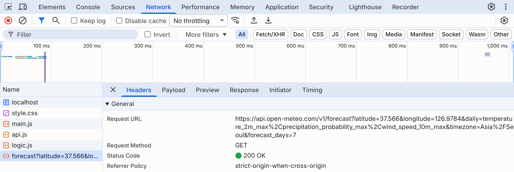

# P0. 내 저장소 만들고 띄우기

템플릿으로 내 저장소를 만들고 clone 하는 것은 지난 실습과 같습니다. 이번에 다른 것은 두 가지입니다. 페이지 파일이 `public/` 폴더 안에 있고, 시작하기 전에 Node 버전을 확인합니다.

## 저장소 만들기 (브라우저)

1. 이 저장소 페이지 오른쪽 위 초록색 **Use this template** → **Create a new repository**.
2. **Owner** 가 내 계정인지 확인하고, **Repository name** 에 `oss-week11` 을 정확히 입력합니다.
3. **Public** 을 고르고 **Create repository**.

## clone 하기 (터미널)

4. 실습 폴더에서 clone 합니다. 주소는 내 저장소의 초록색 **Code** 버튼 → HTTPS 에서 복사합니다.
   ```
   git clone https://github.com/<내 ID>/oss-week11.git
   ```
5. VS Code 에서 **File → Open Folder** 로 방금 생긴 `oss-week11` 폴더를 엽니다. 파일 하나가 아니라 **폴더**를 엽니다.
6. **확인**: VS Code 왼쪽 파일 목록에 아래가 보이면 됩니다.
   - 파일 `.gitignore`, `logic.test.js`, `openMeteo.js`, `package.json`, `README.md`, `server.js`
   - 폴더 `data`, `guide-images`, `problems`, `public`
   - `public` 을 펼치면 `api.js`, `index.html`, `logic.js`, `main.js`, `style.css`

   `server.js` 와 `openMeteo.js` 는 주석만 있고 비어 있습니다. `public/` 안의 파일은 9주차 Run Check 의 완성본입니다. 내가 9주차에 만든 것과 변수 이름이 조금 다를 수 있으니 `public/logic.js` 와 `public/main.js` 를 한 번 읽어 봅니다. 특히 `logic.js` 의 네 함수(`toDays`, `isGoodDay`, `summarize`, `reasons`)가 무엇을 받아 무엇을 돌려주는지 봅니다. P2 에서 이 네 함수를 테스트합니다.

## Node 버전 확인 (VS Code 터미널)

7. VS Code 에서 **Terminal → New Terminal** 로 터미널을 열고 실행합니다.
   ```
   node -v
   ```
8. **확인**: `v22.12.0` 이상의 22 버전, 또는 `v24` 로 시작하면 됩니다.
   - 이번 과제에서 쓰는 vitest 5 가 이 버전들을 요구합니다.
   - `v20.x` 처럼 낮거나 `v23.x` 이면 https://nodejs.org 에서 LTS 를 새로 설치하고, **터미널을 새로 연 뒤** 다시 `node -v` 로 확인합니다.

## 페이지 띄우기 (VS Code 터미널 → 브라우저)

9. 같은 터미널에서 실행합니다. 9주차와 달리 끝이 `.` 이 아니라 **`public`** 입니다. 페이지 파일이 그 폴더 안에 있기 때문입니다.
   ```
   npx serve public
   ```
   `Serving!` 과 `http://localhost:3000` 이 나오면 켜진 것입니다. 이 터미널은 서버가 쓰고 있으니 그대로 두고, 다른 명령은 **새 터미널**(터미널 패널 오른쪽 위 `+`)에서 칩니다.
10. 브라우저 주소창에 `http://localhost:3000` 을 입력하고, Seoul 인 채로 **Check** 를 누릅니다.
11. **확인**: 7줄이 나오고 일부가 초록이며, 요약 줄에 `Seoul: good for a run on 3 of 7 days.` 같은 문장이 나오면 됩니다. 숫자는 예보라 날마다 다릅니다.
    - 표가 안 나오고 상태 줄이 빨간색 `Could not load the forecast (Failed to fetch).` 이면 Open-Meteo 가 응답하지 않는 것입니다. 부록 E19 를 보고, P1 ~ P4 는 그대로 진행합니다.
12. F12 를 눌러 개발자 도구를 열고 **Network** 탭을 고른 뒤 Check 를 한 번 더 누릅니다. 목록에 `forecast?latitude=...` 한 줄이 생깁니다. 그 줄을 누르면 오른쪽 **Headers** 의 Request URL 이 `https://api.open-meteo.com/...` 입니다.

    

    지금은 **페이지가 Open-Meteo 를 직접** 부릅니다. P5 에서 이 요청이 내 서버로 가도록 바꿉니다. 그때 이 화면을 다시 봅니다.

커밋할 것은 없습니다.

---

[← 문제 목록](../README.md#문제) · [다음: P1](P1_vitest.md) · [부록: 흔한 오류](../README.md#부록-흔한-오류)
