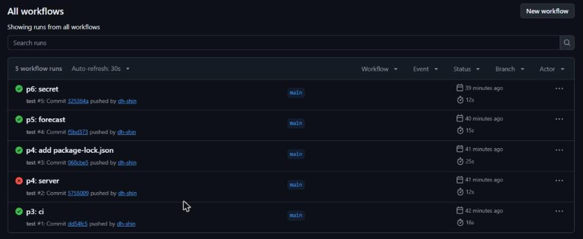
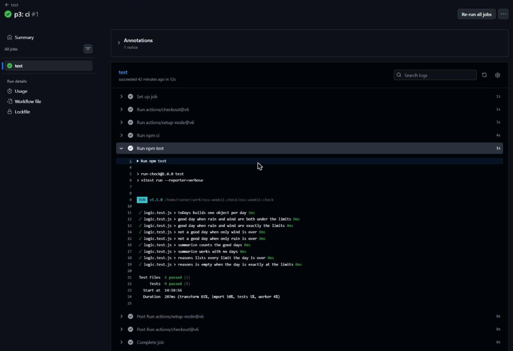

# P3. push 할 때마다 GitHub 가 테스트하게 하기 — `p3: ci`

P2 의 테스트는 내가 `npm test` 를 쳐야만 돌아갑니다. 바쁘면 잊고, 내 컴퓨터에서만 통과하는 경우도 있습니다. 이번 문제에서는 push 할 때마다 GitHub 의 컴퓨터가 저장소를 새로 받아 테스트를 돌리게 합니다. 끝나면 두 가지가 됩니다.

- (1) **설정 파일**: 저장소에 workflow 파일 하나가 생깁니다.
- (2) **초록 체크**: push 한 커밋 옆에 테스트 결과가 표시됩니다.

파일: (새로 만듦) `.github/workflows/test.yml`

## 만들 것

1. VS Code 왼쪽 파일 목록의 빈 곳에서 **New File** 을 누르고, 이름 칸에 아래를 **경로째로** 입력한 뒤 Enter 를 누릅니다. 폴더 두 개와 파일이 한 번에 만들어집니다.
   ```
   .github/workflows/test.yml
   ```
   - 맨 앞에 **점**이 있습니다. `workflows` 는 끝에 s 가 붙습니다.
   - GitHub 는 정확히 이 폴더(`.github/workflows/`) 안의 `.yml` 파일만 workflow 로 읽습니다. 위치나 철자가 다르면 오류도 없이 아무 일도 일어나지 않습니다(부록 E7).

2. 그 파일에 아래 내용의 workflow 를 씁니다.

   | 항목 | 값 |
   |---|---|
   | workflow 이름 | `test` |
   | 언제 돌리나 | `main` 브랜치에 push 될 때, 그리고 pull request 가 있을 때(`pull_request`. 열릴 때와 새 커밋이 올라올 때 모두) |
   | 어디서 돌리나 | `ubuntu-latest` |
   | 단계 1 | 저장소 받기: `actions/checkout@v6` |
   | 단계 2 | Node 설치: `actions/setup-node@v6`, Node 버전 `24` |
   | 단계 3 | 패키지 설치: `npm ci` |
   | 단계 4 | 테스트: `npm test` |

   - 이 파일은 YAML 입니다. **들여쓰기가 구조**입니다. 스페이스 2칸씩 들여 쓰고, 탭 문자는 쓰지 않습니다. VS Code 는 기본 설정에서 Tab 키를 눌러도 스페이스가 들어갑니다.
   - 단계 3 이 `npm install` 이 아니라 **`npm ci`** 인 이유: `npm ci` 는 `package-lock.json` 에 적힌 버전을 그대로 설치하고, lock 파일이 없거나 `package.json` 과 맞지 않으면 설치하지 않고 멈춥니다. 내 컴퓨터와 GitHub 의 컴퓨터가 같은 버전으로 테스트하게 됩니다. P1 에서 `package-lock.json` 을 커밋한 것이 이것 때문입니다.
   - GitHub 의 컴퓨터에는 내 `node_modules` 가 없습니다. 저장소에 올리지 않았기 때문입니다. 그래서 단계 3 이 꼭 필요합니다.

   참고: 10주차 녹강 슬라이드 22장(Config, Runner, Results), 23장(The Workflow File), 28장(package.json vs. package-lock.json). 이 파일은 앱이 달라져도 내용이 같습니다. 슬라이드의 파일을 한 줄씩 무슨 뜻인지 읽으면서 옮겨 씁니다.

## 커밋 (터미널)

3. 이번에는 확인이 push 뒤에 있습니다. 먼저 커밋하고 push 합니다.
   ```
   git add .github/workflows/test.yml
   git commit -m "p3: ci"
   git push
   ```

## 확인 (브라우저)

4. github.com 의 내 `oss-week11` 저장소에서 위쪽 탭 중 **Actions** 를 누릅니다.
5. 목록 맨 위에 `p3: ci` 라는 줄이 있습니다. 방금 push 한 커밋의 메시지입니다.
   - 앞의 표시가 **노란 동그라미**이면 돌아가는 중입니다. 30초 ~ 1분쯤 기다렸다가 F5 를 누릅니다.
   - **초록 체크**가 되면 통과입니다.
   - 줄이 아예 없으면 부록 E7, **빨간 X** 이면 아래 8번을 봅니다.

   

   위 그림은 과제를 끝까지 한 저장소의 목록입니다. 한 줄이 push 한 번이고, 최근 것이 위에 있습니다. 지금 내 저장소에는 맨 아래의 `p3: ci` 한 줄만 있습니다. 넷째 줄처럼 빨간 X 가 붙는 경우는 P4 에서 설명합니다.
6. 그 줄을 누르고, 왼쪽 또는 가운데의 **test** 를 누릅니다. workflow 의 단계가 위에서 아래로 보입니다. `Run npm test` 를 눌러 펼칩니다.
   - 내 터미널에서 본 것과 같은 출력이 있습니다. 맨 아래가 `Tests  9 passed (9)` 이면 GitHub 의 컴퓨터에서도 9개가 통과한 것입니다.
   - 위쪽 `Run npm ci` 를 펼치면 `added 35 packages` 같은 줄이 있습니다. GitHub 의 컴퓨터가 lock 파일대로 새로 설치한 기록입니다.

   
7. 저장소 첫 화면(**Code** 탭)으로 돌아갑니다. 파일 목록 위의 마지막 커밋 줄에 `p3: ci` 와 함께 **초록 체크**가 붙어 있습니다. 앞으로 push 하는 모든 커밋에 이 표시가 붙습니다.
8. 빨간 X 일 때: 6번처럼 들어가 **빨간 X 가 붙은 단계**를 펼쳐 메시지를 읽습니다.
   - `Run npm ci` 에서 멈췄으면 부록 E9.
   - `Run npm test` 에서 멈췄으면 테스트가 실패한 것입니다. 내 컴퓨터에서 `npm test` 를 돌려 같은 실패가 나오는지 봅니다. P2 10번에서 `public/logic.js` 를 되돌리지 않은 경우가 많습니다.
   - 실행 이름 옆에 `Invalid workflow file` 이 있으면 부록 E8.
   - 고친 뒤 다시 커밋하고 push 하면 새 줄이 생깁니다. 커밋 메시지는 `p3: ci fix` 처럼 자유롭게 씁니다. **맨 위 줄이 초록이면** 됩니다. 지난 빨간 줄은 기록으로 남아도 괜찮습니다.

**이제부터 push 할 때마다 Actions 탭의 맨 위 줄이 초록인지 보고 다음 문제로 넘어갑니다.**

---

[← 문제 목록](../README.md#문제) · [이전: P2](P2_tests.md) · [다음: P4](P4_server.md) · [부록: 흔한 오류](../README.md#부록-흔한-오류)
