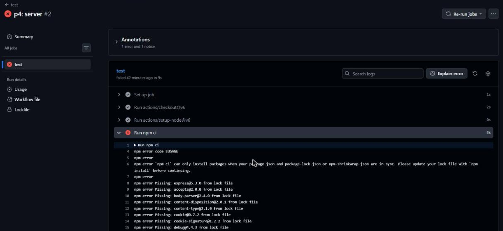

# P4. 내 서버로 페이지 내보내기 — `p4: server`

지금까지 페이지는 `npx serve public` 이 내보냈습니다. `serve` 는 남이 만든 프로그램이라 파일을 그대로 보내 주는 일밖에 못 합니다. 이번 문제에서는 Express 로 **내 서버**를 만들어 `serve` 를 대신합니다. 끝나면 세 가지가 됩니다.

- (1) **페이지 내보내기**: `npm start` 로 켜면 http://localhost:3000 에서 Run Check 가 전과 똑같이 열립니다.
- (2) **첫 route**: `GET /api/health` 에 JSON 으로 응답합니다. 서버가 살아 있는지 묻는 주소입니다.
- (3) **숨겨진 파일**: `public/` 밖의 파일(`server.js` 등)은 주소창으로 열리지 않습니다.

화면은 달라지지 않습니다. 예보도 아직 페이지가 직접 받습니다(P5 에서 옮김).

파일: `server.js`, `package.json`, `package-lock.json`

## 만들 것

1. P0 에서 켜 둔 `npx serve public` 을 끕니다. 그 터미널을 누르고 **`Ctrl+C`**. 끄지 않으면 3000 포트를 두 프로그램이 쓰려고 해서 내 서버가 켜지지 않습니다(부록 E11).
2. 터미널에서 Express 를 설치합니다. 이번에는 **`-D` 가 없습니다.**
   ```
   npm install express
   ```
   `package.json` 을 열어 봅니다. `express` 는 `dependencies` 에, P1 의 `vitest` 는 `devDependencies` 에 있습니다. Express 는 앱이 돌아가는 데 필요하고, vitest 는 개발할 때만 필요하다는 구분입니다.

   참고: 11주차 녹강 슬라이드 16장(Express). 10주차 녹강 슬라이드 9장(Install It as a devDependency)과 비교해 봅니다.

3. `server.js` 에 서버를 씁니다. 맨 위 주석은 그대로 두고 그 아래에 씁니다.

   | 할 일 | 내용 |
   |---|---|
   | 포트 정하기 | 환경 변수 `PORT` 가 있으면 그 값, 없으면 `3000` |
   | 페이지 내보내기 | `public` 폴더의 파일을 그대로 내보냄 |
   | route 하나 | `GET /api/health` → 상태 코드 `200`, 본문 `{"status":"ok"}` |
   | 켜기 | 정한 포트에서 요청을 기다림. 켜지면 `Listening on http://localhost:3000` 을 찍음(숫자는 실제 포트) |

   - 포트를 못 잡았을 때(이미 쓰이는 중) 조용히 넘어가지 않고 **오류로 멈추게** 합니다. Express 5 는 포트를 못 잡아도 `listen` 의 콜백을 부르므로, 콜백이 받은 `error` 를 확인하지 않으면 켜지지 않았는데도 `Listening...` 이 찍힙니다.
   - 본문이 JSON 이면 `res.send` 가 아니라 `res.json` 으로 보냅니다. `Content-Type` 헤더가 `application/json` 으로 붙습니다.

   참고: 11주차 녹강 슬라이드 17장(Hello, Express), 19장(A Route = Method + Path + Handler), 20장(Serve the Page: express.static). **슬라이드와 다른 점** 세 가지:
   - 슬라이드의 포트는 숫자 `3000` 하나입니다. 오늘은 환경 변수 `PORT` 를 먼저 봅니다. 환경 변수는 `process.env.PORT` 로 읽고, "없으면 3000" 은 `??` 연산자로 씁니다. P6 에서 `.env` 파일로 이 값을 넣습니다.
   - 슬라이드의 route 는 `/` 와 `/about` 입니다. 오늘은 `/` 를 route 로 만들지 않습니다. `public/index.html` 이 그 자리에 나갑니다. route 는 `/api/health` 하나입니다.
   - 내 API 의 주소는 전부 `/api/` 로 시작하게 합니다. `public/` 안의 파일 이름과 겹칠 일이 없어집니다.

4. `package.json` 의 `scripts` 에 `start` 를 추가합니다. 명령은 `node server.js` 입니다. `test` 줄은 그대로 둡니다. 두 줄 사이의 쉼표를 확인합니다.

   참고: 11주차 녹강 슬라이드 18장(Run It).

## 확인 (터미널 → 브라우저)

5. 터미널 하나에서 서버를 켭니다.
   ```
   npm start
   ```
   `Listening on http://localhost:3000` 이 나오고 **프롬프트가 돌아오지 않으면** 켜진 것입니다. 서버는 요청을 기다리며 계속 돌아갑니다. 이 터미널은 그대로 두고, 아래 명령은 다른 터미널에서 칩니다.
6. 다른 터미널에서 첫 route 를 불러 봅니다. 페이지 없이 요청만 보내는 것입니다.
   ```
   curl -i http://localhost:3000/api/health
   ```
   첫 줄과 마지막 줄이 이렇게 나오면 됩니다. 사이의 줄들은 헤더입니다.
   ```
   HTTP/1.1 200 OK
   ...
   Content-Type: application/json; charset=utf-8
   ...

   {"status":"ok"}
   ```
   PowerShell 이면 `curl.exe -i ...` 로 칩니다(부록 E15).

   참고: 11주차 녹강 슬라이드 10장(curl: Send a Request Without a Page), 13장(An HTTP Response).

7. 브라우저에서 `http://localhost:3000` 을 열고 Check 를 누릅니다. P0 과 똑같이 7줄이 나오면 (1)이 된 것입니다. (P0 에서 Open-Meteo 가 응답하지 않아 표를 못 봤다면, 여기서도 화면과 빨간 상태 줄이 P0 과 같으면 됩니다.) 주소도 화면도 같지만, 이번에 파일을 보낸 것은 `serve` 가 아니라 내 `server.js` 입니다.
8. 브라우저 주소창에 `http://localhost:3000/server.js` 를 입력합니다.
   - `Cannot GET /server.js` 가 나옵니다. 상태 코드는 404 입니다.
   - 내보내는 폴더가 `public` 뿐이라서, 그 밖에 있는 `server.js` 는 주소로 열 수 없습니다. `http://localhost:3000/main.js` 는 열립니다(`public` 안).
   - P6 에서 비밀 값을 `public` 밖에 두는 것이 이 때문입니다.
9. `server.js` 를 고쳤을 때는 **서버를 껐다 켜야** 반영됩니다. 서버 터미널에서 `Ctrl+C`, 다시 `npm start`. 지금 한 번 해 봅니다. `public/` 안의 파일은 서버를 그대로 두고 브라우저에서 F5 만 하면 됩니다.

   참고: 11주차 녹강 슬라이드 21장([Note] Restart on Save).

10. 다른 터미널에서 `npm test`. 여전히 `9 passed` 입니다. 서버를 만들었지만 규칙(`public/logic.js`)은 건드리지 않았습니다.

## 커밋 (터미널)

11. 커밋하고 push 합니다. **`package-lock.json` 을 같이 넣습니다.** Express 를 설치하면서 lock 파일도 바뀌었습니다.
    ```
    git add server.js package.json package-lock.json
    git commit -m "p4: server"
    git push
    ```
12. **확인**: github.com 의 Actions 탭 맨 위 줄 `p4: server` 가 초록이 될 때까지 봅니다. 빨강이고 `Run npm ci` 에서 멈췄으면 `package-lock.json` 을 빠뜨린 것입니다(부록 E10). GitHub 는 서버를 켜지 않고 테스트만 돌립니다.

    `package-lock.json` 을 빠뜨리고 push 하면 아래처럼 됩니다. `Run npm ci` 단계에 빨간 X 가 붙고, `Missing: express@... from lock file` 줄이 이어집니다. `package.json` 에는 express 가 있는데 lock 파일에는 없다는 뜻입니다. 이때는 `git add package-lock.json` 후 커밋하고 다시 push 합니다.

    

---

[← 문제 목록](../README.md#문제) · [이전: P3](P3_ci.md) · [다음: P5](P5_forecast.md) · [부록: 흔한 오류](../README.md#부록-흔한-오류)
