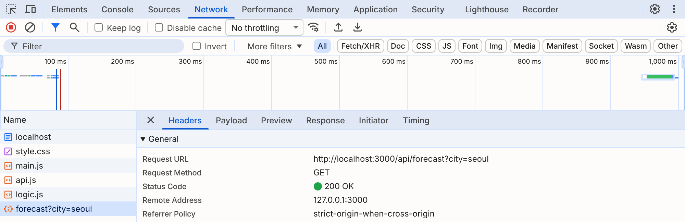

# P5. 예보를 서버가 받아 오게 옮기기 — `p5: forecast`

지금은 페이지(`public/api.js`)가 Open-Meteo 를 직접 부릅니다. 그래서 요청 주소, 위도·경도, 받을 필드 이름이 전부 브라우저로 나가는 파일에 들어 있습니다. 이번 문제에서는 그 일을 서버로 옮깁니다. 끝나면 세 가지가 됩니다.

- (1) **내 API**: `GET /api/forecast?city=seoul` 이 그 도시의 7일을 **하루 단위 객체**로 돌려줍니다.
- (2) **입력 검사**: 모르는 도시를 보내면 서버가 `400` 과 이유를 돌려줍니다.
- (3) **가벼워진 페이지**: 페이지는 내 서버만 부릅니다. Open-Meteo 주소도 위도·경도도 모릅니다.

화면에 보이는 결과는 P4 와 같아야 합니다. 달라지는 것은 요청이 가는 길입니다.

```
전:  페이지 ──────────────────────────→ Open-Meteo
후:  페이지 ──→ 내 서버(/api/forecast) ──→ Open-Meteo
```

파일: `openMeteo.js`, `server.js`, `public/api.js`, `public/main.js`

## 만들 것: 서버 쪽

1. `openMeteo.js` 에 `getDaily({ lat, lon })` 를 만들고 export 합니다.
   - 하는 일은 지금 `public/api.js` 의 `getForecast` 와 같습니다. 그 코드를 이 파일로 **옮깁니다**(`BASE` 포함). 함수 이름만 `getDaily` 로 바꿉니다. 돌려주는 것이 `daily` 이기 때문입니다.
   - 실패했을 때의 메시지는 `HTTP 400` 이 아니라 **`Open-Meteo: HTTP 400`** 으로 바꿉니다. 이 메시지는 서버를 거쳐 페이지의 상태 줄까지 갑니다. 앞에 이름이 없으면 내 서버가 준 400 인지 Open-Meteo 가 준 400 인지 구분할 수 없습니다.
   - 브라우저에서 쓰던 `fetch` 와 `URLSearchParams` 는 Node 에도 들어 있어서 고칠 것이 없습니다.

   - 파일 아래쪽의 `getSampleDaily` 는 주어진 함수입니다. 지우지 않습니다. Open-Meteo 가 응답하지 않을 때만 씁니다(부록 E19).

   참고: 11주차 녹강 슬라이드 23장(① Move the Forecast Call to the Server). 23장은 그림이고, 이 파일의 코드는 슬라이드에 없습니다. `public/api.js` 에 있는 것을 옮기면 됩니다.

2. `public/main.js` 의 `CITIES` 를 **`server.js` 로 옮깁니다.** `public/main.js` 에서는 지웁니다(7번에서 나머지를 고칩니다). 위도·경도는 이제 서버만 압니다.
   - 지운 순간부터 7번을 마칠 때까지 **페이지는 동작하지 않습니다.** Check 를 눌러도 아무 반응이 없고 Console 에 `CITIES is not defined` 가 나옵니다. 정상입니다. 그동안은 페이지를 보지 않고 4, 5번처럼 curl 로 서버만 확인합니다.

3. `server.js` 에 route `GET /api/forecast` 를 추가합니다. 도시는 주소 뒤의 `?city=seoul` 로 받습니다. 값은 `CITIES` 의 키(`seoul`, `daejeon`, `gangneung`) 중 하나입니다.

   | 상황 | 상태 코드 | 본문 |
   |---|---|---|
   | 아는 도시 | `200` | `{ "city": "Seoul", "days": [ 하루 객체 7개 ] }` |
   | 모르는 도시(`?city=tokyo`), 또는 `city` 가 없음 | `400` | `{ "error": "Unknown city: tokyo" }` |
   | 도시는 맞는데 Open-Meteo 에서 받기 실패 | `502` | `{ "error": "<getDaily 가 throw 한 메시지>" }` |

   - `?city=seoul` 의 값은 handler 안에서 `req.query.city` 로 읽습니다.
   - 아는 도시인지는 **`Object.hasOwn(CITIES, 값)`** 으로 묻습니다. `CITIES[값]` 을 꺼내 보고 있으면 통과시키는 방법은 구멍이 있습니다. 객체에는 내가 넣지 않은 이름(`toString`, `constructor` 등)이 원래 달려 있어서 `CITIES["toString"]` 은 `undefined` 가 아니라 함수가 나옵니다. 그러면 `?city=toString` 이 아는 도시로 통과합니다. `Object.hasOwn` 은 내가 직접 넣은 키일 때만 `true` 입니다.
   - `days` 는 `getDaily` 가 준 `daily` 를 **`toDays` 로 바꾼 것**입니다. `toDays` 는 새로 쓰지 않고 `./public/logic.js` 에서 import 합니다. 하루 객체의 모양은 `{ "date": "2026-11-14", "max": 12.3, "wind": 8.1, "rain": 20 }` 입니다.
   - `city` 는 도시의 `name`(`"Seoul"`)입니다. 위도·경도는 응답에 넣지 않습니다.
   - `getDaily` 는 기다려야 하는 함수입니다. handler 를 `async` 로 만들고 `await` 로 부릅니다. 실패는 `try`/`catch` 로 받습니다.
   - `400` 을 보낸 줄은 `return` 으로 끝냅니다. 빼먹으면 아래 코드까지 실행되어 응답을 두 번 보내려다 오류가 납니다(부록 E18).
   - `502`(Bad Gateway)는 "내 서버는 멀쩡한데, 내가 대신 물어본 뒤쪽 서버가 문제" 라는 뜻입니다. `400` 은 "보낸 쪽이 잘못 보냈다" 입니다.

   참고: 11주차 녹강 슬라이드 14장(Status Codes), 24장(GET /api/forecast), 27장(The Rules Stay in logic.js), 31장(Check Every Input on the Server). **슬라이드와 다른 점** 두 가지. 도시 세 곳과 `toDays` 가 만드는 하루 객체의 키가 다릅니다(`min` 이 없고 `wind` 가 있음). 그리고 24장은 아는 도시인지를 `CITIES[req.query.city]` 로 확인하지만, 오늘은 위에 적은 이유로 `Object.hasOwn` 을 씁니다. 나머지 route 의 모양은 같습니다.

## 확인 1: 페이지보다 먼저 curl 로 (터미널)

페이지를 고치기 전에 서버가 맞게 응답하는지부터 봅니다. 페이지까지 고친 뒤에 안 되면 서버가 틀렸는지 페이지가 틀렸는지 알기 어렵습니다.

4. 서버를 껐다 켭니다(서버 터미널에서 `Ctrl+C`, `npm start`). 다른 터미널에서 요청을 보냅니다. 주소에 `?` 가 있으므로 **큰따옴표로 감쌉니다.**
   ```
   curl -i "http://localhost:3000/api/forecast?city=seoul"
   ```
   첫 줄이 `HTTP/1.1 200 OK` 이고, 마지막 줄이 아래 모양이면 됩니다. 숫자는 예보라 다릅니다.
   ```
   {"city":"Seoul","days":[{"date":"2026-11-14","max":12.3,"wind":8.1,"rain":20},{"date":...
   ```
   첫 줄이 `HTTP/1.1 502 Bad Gateway` 이고 본문이 `{"error":"fetch failed"}` 이면 내 서버는 맞게 동작한 것이고, Open-Meteo 에 닿지 못한 것입니다. 부록 E19 의 방법으로 저장된 응답을 써서 계속합니다.

   `days` 안의 객체가 7개이고 키가 `date`, `max`, `wind`, `rain` 네 개인지 봅니다. Open-Meteo 의 긴 필드 이름(`temperature_2m_max` 등)이 **보이지 않아야** 합니다.
5. 모르는 도시, `city` 를 아예 안 붙인 경우, 객체에 원래 달린 이름을 보냅니다.
   ```
   curl -i "http://localhost:3000/api/forecast?city=tokyo"
   curl -i "http://localhost:3000/api/forecast"
   curl -i "http://localhost:3000/api/forecast?city=toString"
   ```
   셋 다 첫 줄이 `HTTP/1.1 400 Bad Request` 이고, 본문이 각각 `{"error":"Unknown city: tokyo"}`, `{"error":"Unknown city: undefined"}`, `{"error":"Unknown city: toString"}` 이면 됩니다. 셋째가 `502` 로 나오면 `Object.hasOwn` 으로 확인하지 않은 것입니다.

   참고: 11주차 녹강 슬라이드 25장(Try It Before the Page Uses It).

## 만들 것: 페이지 쪽

6. `public/api.js` 의 `getForecast` 를 고칩니다.
   - 받는 것: 위도·경도 객체가 아니라 **도시 키 문자열**(`"seoul"`).
   - 부르는 곳: Open-Meteo 가 아니라 **내 서버**의 `/api/forecast?city=...`. 주소는 `http://localhost:3000` 을 붙이지 않고 `/api/...` 부터 씁니다. `/` 로 시작하는 경로는 "이 페이지를 보내 준 바로 그 서버" 로 갑니다.
   - 응답 본문은 성공이든 실패든 JSON 입니다. 먼저 본문을 읽고, 응답이 실패(200 대가 아님)면 본문의 `error` 를 메시지로 throw 합니다. 서버가 적어 준 이유(`Unknown city: tokyo`)가 그대로 상태 줄까지 갑니다.
   - 성공이면 읽은 본문(`{ city, days }`)을 그대로 돌려줍니다.
   - 1번에서 옮긴 코드(`BASE`, `URLSearchParams` 부분)는 이 파일에 남기지 않습니다.

   참고: 11주차 녹강 슬라이드 26장(The Page Calls Your Server).

7. `public/main.js` 를 **세 군데** 고칩니다. 2번에서 `CITIES` 는 이미 지웠습니다.

   | 어디 | 지금 | 고친 뒤 |
   |---|---|---|
   | 맨 위 import | `logic.js` 에서 `toDays` 도 가져옴 | `toDays` 를 뺌. 이제 서버가 부름 |
   | submit 함수 | `CITIES` 에서 도시 객체를 꺼내 `getForecast` 에 넘기고, 받은 `daily` 를 `toDays` 로 바꿔 `state.days` 에 넣음 | `<select>` 의 값(`citySelect.value`)을 그대로 `getForecast` 에 넘기고, 받은 `city` 와 `days` 를 `state` 에 넣음 |
   | `render` 의 요약 줄 | `state.city.name` | `state.city`. 이제 객체가 아니라 이름 문자열 |

   - 셋째 줄을 빠뜨려도 오류는 나지 않습니다. 대신 요약 줄이 `undefined: good for a run on ...` 이 됩니다(부록 E17).
   - `dayRow` 와 기준 칸의 `input` 이벤트는 고칠 것이 없습니다. `state.days` 의 모양이 전과 같기 때문입니다.

## 확인 2: 페이지에서 (브라우저)

8. `public/` 안의 파일만 고쳤으므로 서버는 그대로 두고, 브라우저에서 F5. Seoul 로 Check.
   - 7줄과 초록 줄, 요약 문장 `Seoul: good for a run on 3 of 7 days.` 가 P4 때와 같은 모양으로 나옵니다.
   - 기준 칸을 바꾸면 Check 를 다시 누르지 않아도 색이 바뀝니다(9주차 P5 가 그대로 동작).
9. F12 → **Network** 탭을 열고 Check 를 다시 누릅니다.
   - 목록에 **`forecast?city=seoul`** 한 줄이 생깁니다. 그 줄을 누르면 Request URL 이 `http://localhost:3000/api/forecast?city=seoul` 입니다.

     

   - P0 12번에서 봤던 `api.open-meteo.com` 으로 가는 요청은 **없습니다.** Open-Meteo 는 이제 서버가 부르므로 브라우저에서는 보이지 않습니다.
   - **Response** 탭에는 4번에서 curl 로 본 것과 같은 JSON 이 있습니다.
10. 서버가 꺼졌을 때 페이지가 어떻게 되는지 봅니다. 서버 터미널에서 `Ctrl+C` 로 끄고, 브라우저에서 Check.
    - 상태 줄이 빨간색 `Could not load the forecast (Failed to fetch).` 가 되고, 이전 표는 남아 있습니다(8번에서 표를 받지 못했다면 빈 표 그대로입니다).
    - 다시 `npm start` 로 켜고 Check. 빨간 글자가 사라집니다.
    - 페이지 파일은 이미 브라우저에 와 있어서 화면은 그대로지만, 데이터는 서버가 있어야 받을 수 있습니다.
11. 다른 터미널에서 `npm test`. 여전히 `9 passed` 입니다. `toDays` 를 부르는 곳이 페이지에서 서버로 바뀌었을 뿐, 함수는 `public/logic.js` 에 그대로 하나만 있습니다. 서버용으로 복사본을 만들지 않았기 때문에 테스트도 그대로 유효합니다.
12. 페이지 쪽 파일에 옮기기 전의 흔적이 남지 않았는지 터미널에서 찾아봅니다. `git grep` 은 저장소의 파일에서 글자를 찾는 명령이고, 끝의 `-- public` 은 `public` 폴더 안에서만 찾으라는 뜻입니다.
    ```
    git grep -n "api.open-meteo.com" -- public
    git grep -n "37.566" -- public
    ```
    둘 다 **아무것도 나오지 않으면** 됩니다. 줄이 나오면 그 파일의 그 줄에 Open-Meteo 주소나 서울의 위도가 아직 남아 있는 것입니다.

## 커밋 (터미널)

13. 커밋하고 push 합니다.
    ```
    git add openMeteo.js server.js public/api.js public/main.js
    git commit -m "p5: forecast"
    git push
    ```
14. **확인**: Actions 탭 맨 위 줄 `p5: forecast` 가 초록.

---

[← 문제 목록](../README.md#문제) · [이전: P4](P4_server.md) · [다음: P6](P6_secret.md) · [부록: 흔한 오류](../README.md#부록-흔한-오류)
